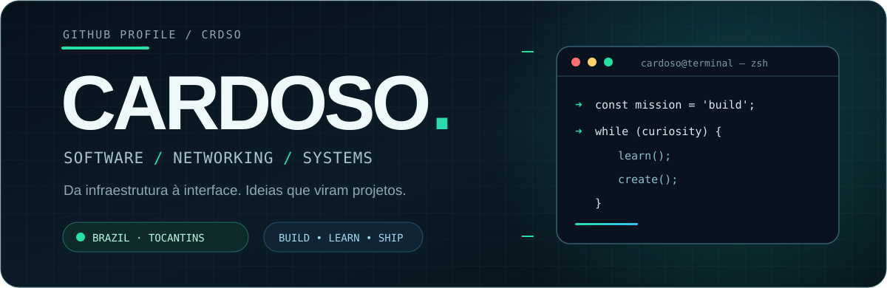
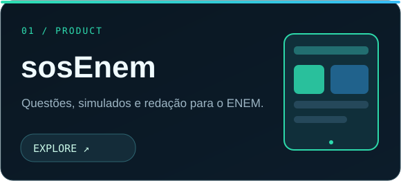
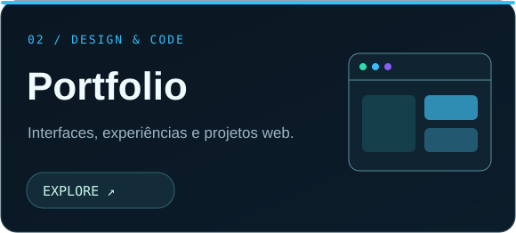
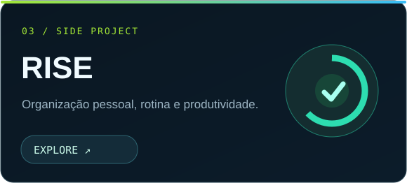
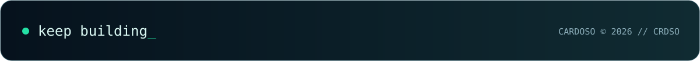

Developer in progress.   Interfaces bem pensadas, sistemas úteis e curiosidade por tudo que acontece por trás deles.

01 / ABOUT ME
Sou Cardoso, estudante de Redes de Computadores no IFTO e desenvolvedor de projetos web. Gosto tanto de criar uma interface agradável quanto de entender a infraestrutura que faz tudo funcionar.
cardoso@github:~$ ./whoami
> Estudante de Redes de Computadores · IFTO
> Desenvolvimento web · Sistemas · Infraestrutura
> Brasil · Tocantins

cardoso@github:~$ ./current-focus
> Construir produtos reais, aprender na prática e melhorar a cada entrega.

02 / FEATURED PROJECTS

<table>
  <tr>
    <td width="50%" align="center" valign="top">
      
       Plataforma de estudos com questões, simulados, redação e planos de estudo.
    </td>
    <td width="50%" align="center" valign="top">
      
       Meu espaço para reunir projetos, design e experiências web.
    </td>
  </tr>
  <tr>
    <td width="50%" align="center" valign="top">
      
       Projeto de organização pessoal e produtividade.
    </td>
    <td width="50%" align="left" valign="middle">
      <strong>💡 Como eu penso projetos</strong>
        
      <code>01.</code> Identificar um problema real.  
      <code>02.</code> Projetar uma solução simples.  
      <code>03.</code> Construir, testar e melhorar.  
      <a href="https://github.com/crdso?tab=repositories">Explorar todos os repositórios →</a>
    </td>
  </tr>
</table>

03 / TOOLBOX

Development

TypeScript · JavaScript · Python · React · Next.js · HTML · CSS · Tailwind

Backend & infrastructure

Supabase · PostgreSQL · Docker · Linux · Git · GitHub · VS Code · Windows

04 / CONTRIBUTIONS • SNAKE.EXE

Minha atividade no GitHub, vista de um jeito um pouco diferente.

<picture>
  <source media="(prefers-color-scheme: dark)" srcset="https://raw.githubusercontent.com/crdso/crdso/output/dist/github-snake-dark.svg" />
  <source media="(prefers-color-scheme: light)" srcset="https://raw.githubusercontent.com/crdso/crdso/output/dist/github-snake.svg" />
  
</picture>

Gerada automaticamente via GitHub Actions. Atualização diária.

05 / LET'S CONNECT

Tem uma ideia, um projeto ou só quer trocar conhecimento?

